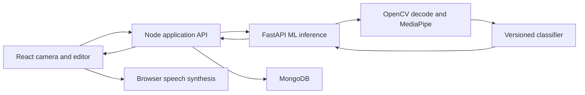

# Practical architecture and interaction design

## Camera ownership

For collection and a local OpenCV demonstration, Python owns the webcam. For the final browser application, React uses the browser's getUserMedia API. It sends downscaled JPEG frames to Node.js, which forwards them to FastAPI. Python/OpenCV decodes frames, MediaPipe extracts landmarks and the saved classifier predicts letters. Do not let Python VideoCapture and the browser compete for the same camera. A deployed server cannot access a student's laptop through VideoCapture(0).

## Final request path

React retains editable text and camera controls. Node owns user/session scope, vocabulary, history, persisted sequences and practice records. FastAPI owns model loading, feature extraction, inference and per-stream sequencing. MongoDB stores app data, not raw frames. Browser speechSynthesis speaks the final text after a user clicks Play; the API can return validated text to speak, but does not claim to synthesize an audio file. If an audio-generation API is mandatory, a distinct approved TTS engine must be selected later rather than inventing output.

Use one in-flight frame request per client and monotonically increasing frame IDs/timestamps. Start around 5-10 inference requests per second and measure actual latency. Reject stale responses. Tracking state must not leak across users: create per-stream detectors with cleanup or use stateless image inference initially. Run model inference outside FastAPI's event loop. Limit frame dimensions and request sizes.

## Recognition and temporal boundaries

Start with a static MLP trained on the 128 landmark features. Fit all scaling on training data only; split by signer when possible, or disclose session-only evaluation. Select thresholds on validation data and evaluate test data once. Softmax or predict_proba values are model scores, not proven calibrated correctness probabilities.

For deliberate continuous spelling, require the candidate to remain stable for a configurable elapsed duration, then emit it once. Latch emission until a deliberate neutral/release interval or an explicit Next letter action rearms it. A changed predicted letter alone must not rearm the gate, because transition frames can resemble other letters. Low confidence can create a pending candidate for user confirmation; it cannot automatically emit. Repeated letters such as LL require release or explicit rearm. Missing detections are ambiguous; use a sustained interval and a manual control, and test occlusion separately.

This is assisted continuous spelling with explicit boundaries, not unconstrained natural fingerspelling recognition. Only introduce LSTM when real ordered gesture clips and motion-sensitive classes justify it; isolated-clip LSTM classification still needs segmentation. CTC or a sequence-to-text model needs aligned/unsegmented sequence data and is outside the initial mini-project baseline. CNN is reserved for a separately evaluated image baseline if necessary.

## Final UI specification

Use React with semantic HTML and CSS. A warm off-white surface, deep navy text and teal actions create a calm workspace; amber marks pending review and red marks errors. Do not rely on colour alone. Maintain readable contrast, visible keyboard focus and large camera controls.

Desktop: a left navigation rail, a large live camera panel and a sentence composer alongside it. Mobile: stack camera, feedback and editor. Camera state must be visible: Off, Requesting permission, Live, Paused, Error. Display the predicted letter, model score, tracking status, stabilization progress and whether insertion is armed. Never show fake accuracy statistics.

Navigation: Dashboard, Live spelling, Compose, Vocabulary, History, Practice and Output. The editor supports replace, backspace, undo, space and explicit letter confirmation. Suggestions are prefix lookup ranked by dictionary/custom/history frequency; label them word suggestions, not an advanced language model. Selecting a suggestion replaces only the current unfinished word. Practice records target, predicted label, score, outcome and timestamp. The reference image must be vetted and appropriately licensed.

## Planned MongoDB collections

- users: pseudonymous _id, createdAt, preferences; durable authentication scope decided before external use.
- gestureReferences: label, variant, kind, requiredHands, source, review status and mappingVersion.
- sequences: userId, ordered letter events, source prediction IDs, corrections and timestamps.
- utterances: userId, finalText, words and createdAt; stores final words/sentences.
- vocabulary: userId, normalizedWord, displayWord and usage count; compound uniqueness per user/word.
- history: userId, utteranceId, savedAt and optional label; retrieval references stored text.
- practiceRecords: userId, target, prediction, score, result and recordedAt.

These are schema specifications, not a connected database in Phase 1. The database stage must implement validation, CRUD, indexes, ownership checks and real persistence tests before it is marked complete.
